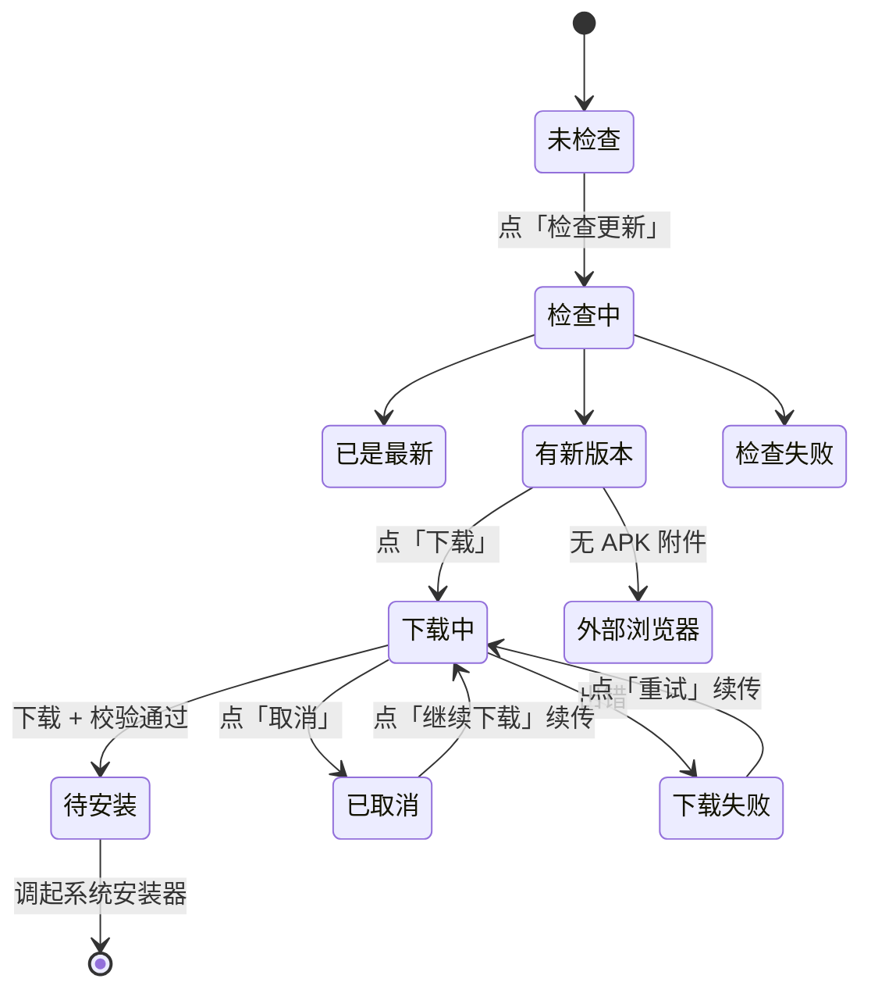

# 应用内更新下载 · 设计文档

日期：2026-10-15
状态：已确认（用户选择：前台服务 + 通知栏进度 / 手动安装 / 断点续传 / 取消保留断点 + 清理缓存入口 / 通知带取消按钮 / 保留发布页降级退路）

## 1. 背景与目标

现状：能检查到新版本，但用户点「打开发布页」后跳到浏览器，需要自己在 GitHub 页面找 APK、下载、再手动打开安装。中途失败只能从头再来，且全程看不到任何进度。

目标：把「下载」这一步收回应用内，点击即下载，进度可见。

- 检查到新版本后直接给「下载」按钮，不再默认跳浏览器；
- 下载进度在**卡片内**与**通知栏**两处同步可见；
- 断点续传：断网/切网/取消后重试，从已下载的字节继续；
- 下载完成做完整性校验，然后由用户手动点「安装」；
- Release 没有 APK 附件、或下载持续失败时，保留「打开发布页」作为退路。

## 2. 现状与约束

| 事实 | 位置 | 影响 |
|---|---|---|
| 已解析出 `apkUrl`，但 UI 只用 `pageUrl` | `update/UpdateChecker.kt:47-54`、`feature/settings/SettingsScreen.kt:342-346` | 下载能力的地基已存在，只差用起来；同时需为其补 `apkSize` 与 `apkDigest` 两个字段（见下） |
| 现有 OkHttpClient `readTimeout=20s` | `di/AppModule.kt:82-87` | **不可复用**，长下载需独立客户端 |
| 无 FileProvider、无 `REQUEST_INSTALL_PACKAGES` | `app/src/main/AndroidManifest.xml` | 安装链路需从零搭 |
| 前台服务模式已成熟 | `capsule/LiveCapsuleService.kt:53-86` | 照抄 `ServiceCompat.startForeground` 结构 |
| 通知渠道工厂已存在 | `alarm/Notifications.kt:18-46`、`capsule/CapsuleNotifier.kt:35-44` | 新增 `update` 渠道沿用同一写法 |
| 测试栈只有 JUnit4，无 Robolectric | `app/build.gradle.kts:141` | 纯逻辑必须与 Android API 分离才可测 |
| 版本号硬编码「当前 v1.0.0」 | `feature/settings/SettingsScreen.kt:326` | 顺手修：实际已是 1.0.2，改读 `BuildConfig.VERSION_NAME` |

**GitHub API 已提供官方摘要**（实测 v1.0.2）：

```
assets[0].digest = "sha256:d3dba9255114fb43cbf8933e3ab2fcf060f5d19edd667bb50d9481ed33193214"
assets[0].size   = 46920382
```

这让完整性校验从「只比长度」升级为「官方哈希比对」。`digest` 在旧 Release 上可能缺失，需按可选字段处理。

对应的数据模型改动（`UpdateChecker.UpdateInfo` 扩展）：

```kotlin
data class UpdateInfo(
    val version: String,
    val pageUrl: String,
    val apkUrl: String?,
    val apkSize: Long?,       // 新增：assets[].size，用于下载前展示大小与进度分母
    val apkDigest: String?,   // 新增：assets[].digest（"sha256:..."），校验用
    val notes: String,
)
```

两者都按可空处理：`apkSize` 缺失时进度分母改用响应头的 `Content-Length`，`apkDigest` 缺失时跳过哈希校验（见 §6）。

## 3. 架构

```
feature/settings/SettingsScreen.kt      观察状态，渲染卡片各态
feature/settings/SettingsViewModel.kt   转发 downloader 状态；触发下载/取消/安装/清理
update/ApkDownloadService.kt            前台服务（dataSync）：保进程 + 通知栏进度
update/ApkDownloader.kt                 @Singleton：状态唯一来源 + 下载协程体
update/ResumableDownload.kt             纯逻辑：Range 决策 / 速率 / 校验 / 清理规则
update/UpdateNotification.kt            通知渠道 + 进度通知（含取消 action）
update/ApkInstaller.kt                  FileProvider URI + 安装 Intent + 未知来源引导
res/xml/file_paths.xml                  FileProvider 路径白名单
```

### 3.1 状态归属：`@Singleton ApkDownloader`

状态持有者与执行者分离：

- `ApkDownloader` 是**唯一事实来源**，暴露 `StateFlow<DownloadState>`；UI 与 Service 注入同一个实例。
- 下载协程由 **Service 的 scope 启动**，因此下载存活期 = 服务存活期，生命周期语义清晰；进程被保活期间即使 UI 退到后台，协程照跑。
- UI 离开设置页不影响下载（状态在 Singleton，协程在 Service）。

不选 WorkManager 的理由：本场景用户盯着进度条，需要即时反馈与即时取消。WorkManager 的 `setProgress(Data)` 有序列化开销与节流（Data 还有 10KB 上限），取消要经调度器响应；而 WorkManager 的强项（约束管理、进程被杀后自动重试）在本场景用不上。

### 3.2 状态模型

```kotlin
sealed interface DownloadState {
    data object Idle : DownloadState
    data class Running(
        val version: String,
        val downloadedBytes: Long,
        val totalBytes: Long?,      // null = 响应无 Content-Length
        val bytesPerSecond: Long,
        val etaSeconds: Long?,
    ) : DownloadState
    /** 用户取消或服务被回收：进度保留，可续传 */
    data class Paused(
        val version: String,
        val downloadedBytes: Long,
        val totalBytes: Long?,
    ) : DownloadState
    data class Ready(val version: String, val file: File, val sizeBytes: Long) : DownloadState
    /** @param canResume 已知服务端支持续传时为 true，决定卡片是否给「继续」而非「重下」 */
    data class Failed(val version: String, val reason: String, val canResume: Boolean) : DownloadState
}
```

`totalBytes` 为 null 时 UI 显示不确定进度（转圈）而非假百分比。

## 4. 状态机与卡片 UI



卡片（`StaggerIn(index = 6)`）各态渲染：

| 状态 | 主文案 | 操作 |
|---|---|---|
| 未检查 | 通过 GitHub Releases 分发（当前 v1.0.2） | 检查更新 |
| 检查中 | 正在检查… | 检查更新（禁用） |
| 已是最新 | 已是最新版本 v1.0.2 | 重新检查 |
| 检查失败 | 检查更新失败：<原因> | 重试 |
| 有新版本 | 发现新版本 v1.0.3 · 大小 44.7 MB | **下载** / 打开发布页 |
| 无 APK 附件 | 发现新版本 v1.0.3（该版本未提供安装包） | 打开发布页 |
| 下载中 | 已下载 12.4 / 44.7 MB · 约剩 30 秒 ＋ 进度条 | 取消 |
| 已取消 | 已取消 · 已保留 12.4 MB 进度 | 继续下载 / 打开发布页 |
| 下载失败 | 下载失败：<原因> | 重试 / 打开发布页 |
| 待安装 | 下载完成，待安装（44.7 MB） | **安装** / 打开发布页 |
| 校验失败 | 安装包校验失败，请重试 | 重新下载 / 打开发布页 |

「清理缓存」入口：卡片内一个 TextButton，仅在 `filesDir/updates/` 有可清理内容时出现，文案带占用大小（如「清理下载缓存（56.3 MB）」），点击弹确认框后清空（见 §9）。

**下载中隐藏该入口**（真机验证时发现的缺陷，2026-10-15）：两处原因——① 下载进行中 `updateCacheBytes` 仍是上一次终态的旧值（设计上刻意不在每个分片回调里列目录），显示出来会误导（卡片写着「已下载 8.8 MB」而入口写着「清理下载缓存（2.7 MB）」）；② 分片正被 `RandomAccessFile` 写入，此时清空会让这次下载白跑（Linux 上删除已打开的 inode 不会立刻失败，但随后的 `renameTo` 会因源文件不存在而失败，最终落到「安装包保存失败」）。另外 `SettingsViewModel.clearUpdateCache()` 也做了一道兜底拦截，覆盖「确认框已弹出、下载才开始」这一竞态。

## 5. 断点续传协议

`.part`（数据）+ `.meta`（元数据）同存于 `filesDir/updates/`，文件名带版本，避免跨版本串号。

```kotlin
@Serializable
data class PartMeta(
    val version: String,
    val url: String,
    val etag: String?,          // 服务端 ETag，用于 If-Range
    val lastModified: String?,
    val totalBytes: Long,
    val digest: String?,        // "sha256:..."，可空
)
```

请求与判定：

```
每次(重)试:
  1. 读 .meta；有且 partBytes > 0 → 带 Range: bytes=<partBytes>- 与 If-Range: <etag>
  2. 按响应判定:
     206 → 服务端支持续传且资源未变 → 追加写入 .part
     200 → 服务端忽略 Range，或 If-Range 判定资源已变 → 清空 .part，从头写
     416 → Range 越界：partBytes == totalBytes 视为已完整 → 直接进校验
                           partBytes >  totalBytes 视为损坏 → 清空重下
     其他 4xx/5xx → 失败；5xx 或 IO 异常标记 canResume = true
  3. 完成条件: partBytes == totalBytes（有此值时必须相等）
  4. 校验通过 → 重命名为 <version>.apk，删除 .meta
```

用 `If-Range` 而非手工比对 ETag：让服务端决定「资源未变才给 206」，客户端不需要额外往返，也能挡住「Release 资产被替换导致新旧分片拼接出损坏 APK」这一整类问题。只比长度无法发现这种损坏。

**注意（已实测，2026-10-15）**：GitHub 的资产下载会 302 跳到 `release-assets.githubusercontent.com`（Azure Blob + CDN，`Location` 里带有时限 SAS 参数）。实测：重定向后 `Range` **保留**，返回 `206 Partial Content` 且带 `Content-Range: bytes 0-1023/46920382`；OkHttp 跟随重定向时只剥掉跨主机的 `Authorization`，`Range`/`If-Range` 原样保留。因此**不需要**「解析 `Location` 直连最终 URL」的退路。

**另一处实测结论：该 CDN 不认 `If-Range`。** 用错误的 ETag 与正确的 ETag 各发一次 `Range: bytes=1000-`，两次都返回 `206`（Azure Blob 的 GET 条件头只支持 If-Match / If-None-Match / If-Modified-Since / If-Unmodified-Since，不含 If-Range）。也就是说「让服务端判定资源未变才给 206」在本站**不成立**；真正兜住「Release 资产被替换、新旧分片拼出一个坏 APK」的是 §6 的官方 `digest` 校验 —— 拼出来的文件长度可能正好对得上，但哈希一定不符，于是删分片、`Failed(canResume=false)`、要求重新下载。仍保留发送 `If-Range`（符合 RFC、无副作用，且上游哪天开始支持即自动生效）。

同时实测：`206` 的 `Content-Length` 只是**剩余**字节数（`Range: bytes=0-1023` → `Content-Length: 1024`），所以进度分母只能取 `Content-Range` 的 total，不能取 `Content-Length`；越界 Range 返回 `416`，与 §5 的分支设计一致。

## 6. 完整性校验

下载完成、**重命名之前**对 `<version>.apk.part` 依次校验，通过后才重命名并删除 `.meta`：

1. **长度**：`partBytes == totalBytes`（`totalBytes` 已知时必须成立）；
2. **哈希**：`digest` 存在时，流式计算 `SHA-256` 与官方值比对（46MB 约 0.2 秒）；
3. 任一不过 → 删除文件、置 `Failed`、卡片提示重试。

`digest` 缺失时退化为只校验长度——可选字段不当作必需。哈希比对是纵深防御：长度对但内容坏（CDN 分片损坏、中间篡改）时，只有哈希能发现。

## 7. 安装链路

用户手动点「安装」：

```
点「安装」
  ├─ packageManager.canRequestPackageInstalls() == false
  │    → 引导至 Settings.ACTION_MANAGE_UNKNOWN_APP_SOURCES
  │      （带 package: 的 URI；返回后由 LifecycleEventEffect(ON_RESUME) 刷新状态）
  └─ true
       → Intent(ACTION_VIEW)
           .setDataAndType(uri, "application/vnd.android.package-archive")
           .addFlags(FLAG_GRANT_READ_URI_PERMISSION)
         uri = FileProvider.getUriForFile(context, "${applicationId}.fileprovider", apkFile)
```

两个硬性要求：

- **FileProvider 不可省**：minSdk 26，`file://` URI 在 API 24+ 会抛 `FileUriExposedException`；
- **「安装未知应用」是运行时授权**，不是普通权限弹窗，必须用 `canRequestPackageInstalls()` 判断后引导到系统页。

安装完成后本应用进程会被系统重启为新版本，无需额外收尾。

## 8. 权限与清单改动

| 类别 | 改动 | 说明 |
|---|---|---|
| 权限 | `REQUEST_INSTALL_PACKAGES` | 调起系统安装器 |
| 权限 | `FOREGROUND_SERVICE_DATA_SYNC` | `dataSync` 类型前台服务（API 34+ 必需） |
| Service | `.update.ApkDownloadService`，`foregroundServiceType="dataSync"` | 承载下载，保进程 |
| Provider | `androidx.core.content.FileProvider`，authority `${applicationId}.fileprovider` | 交付 APK 给安装器 |
| 资源 | `res/xml/file_paths.xml` | `<files-path name="updates" path="updates/" />` |
| 通知渠道 | `update`（IMPORTANCE_LOW） | 与课程胶囊渠道隔离 |
| 存储 | 内部 `filesDir/updates/` | 免新存储权限 |

**前台服务超时**：`dataSync` 在 Android 15+ 有 6 小时累计上限，需实现 `onTimeout()`（API 35+）收尾并转 `Failed`。46MB 下载远达不到该上限，但必须正确处理，否则系统回调时会抛异常。

`START_NOT_STICKY`：不做静默重启，断点已落盘，用户重试即可。

## 9. 文件生命周期与清理

`filesDir/updates/` 下三类文件：

```
<version>.apk.part   下载中的数据
<version>.apk.meta   断点元数据
<version>.apk        校验通过、待安装
```

| 时机 | 动作 |
|---|---|
| 用户点「取消」 | **保留** `.part` 与 `.meta`（可续传），状态置 `Paused` |
| 下载完成 | 重命名 `.apk`，删除 `.meta` |
| 校验失败 | 删除该版本全部文件 |
| 校验通过但安装前 | 保留 `.apk`（清理缓存会删它，需确认框提示） |
| 应用启动时 | 清理「版本 <= 当前已安装版本」的残留（已装过的不再需要） |
| 点「清理下载缓存」 | 清空 `updates/` 全部内容，弹确认框（含已下载安装包时文案明确列出） |

启动清理的判据是纯函数 `shouldClean(fileName, currentVersion)`，可单测。

## 10. 通知栏

- 渠道：`update`，`IMPORTANCE_LOW`（不响铃不震动），`ensureChannel` 在服务 `onCreate` 调用；
- 内容：标题「正在下载更新 v1.0.3」，正文「12.4 / 44.7 MB · 约剩 30 秒」，`setProgress(100, percent, false)`，`setOnlyAlertOnce(true)`；
- 节流：仅当「距上次刷新 ≥ 500ms」**且**「整数百分比已变化」时才刷新，避免高频 IPC；下载结束时无条件刷新一次最终态；
- **取消 action**：`PendingIntent.getService(ACTION_CANCEL)` → 服务转 `downloader.cancel()`；
- 完成时：`stopForeground(REMOVE)` 并撤销进度通知，发一条「更新已下载，点按返回应用安装」通知，点按打开 `MainActivity`（安装引导仍在卡片内完成，避免在通知里做未知来源引导）；
- 通知权限被拒（Android 13+）：下载照跑，仅无通知栏进度，卡片内进度不受影响。

## 11. 错误与降级

| 情形 | 处理 |
|---|---|
| 无 `Content-Length` | 不确定进度（转圈），不显示百分比与 ETA |
| 无 APK 附件 | 卡片直接给「打开发布页」，不显示下载按钮 |
| 网络中断 | `Failed(canResume=true)`，卡片给「重试」（续传）与「打开发布页」 |
| 磁盘空间不足 | 写前检查可用空间，不足则立即失败并提示，不进入下载 |
| 服务被系统回收 | 状态保持 `Paused`，`.part` 已落盘，重进卡片可续 |
| 校验失败 | 删文件，`Failed(canResume=false)`，给「重新下载」 |
| 用户未授予安装权限 | 引导至系统页，返回后刷新；不阻断下载 |

## 12. 测试策略

纯逻辑集中在 `ResumableDownload.kt`，输入为 `ByteArray`/`InputStream` 与基本类型，不依赖 `Context`/`File`，可直接 JUnit 跑（项目无 Robolectric）：

| 单测项 | 覆盖 |
|---|---|
| Range 决策 | 206 续传 / 200 重下 / 416 已完整 / 416 损坏 / 4xx / 5xx |
| 元数据 | `.meta` 序列化往返、损坏 JSON 的恢复、缺失字段默认值 |
| 哈希校验 | 匹配 / 不匹配 / digest 缺失时跳过 / 空文件 |
| 速率与 ETA | 滑动窗口估算、样本不足时为 null、速率归零不除零 |
| 字节格式化 | MB/GB 进位与小数位，含 0 与超大值边界 |
| 清理规则 | `shouldClean` 各版本比较（含跨大版本、带后缀） |
| 通知节流 | 500ms 与整数百分比双条件（两者同时满足才刷新）、结束时无条件刷新 |

真机验证清单（无法单测，须实机跑）：

1. 完整下载 → 校验 → 安装，全链路一次通过；
2. 下载中切飞行模式 → 失败标记可续 → 恢复网络 → 重试从断点继续（对照已下载字节数）；
3. 下载中点「取消」→ `.part` 与 `.meta` 留存 → 「继续下载」续传成功；
4. 下载中退到后台/切到其它 App → 通知栏进度持续更新，返回后卡片进度一致；
5. 通知栏「取消」按钮生效；
6. 未授予「安装未知应用」时点「安装」→ 正确跳系统页，授权返回后可装；
7. 服务运行期间 `adb shell dumpsys activity services` 确认 FGS 类型为 `dataSync`；
8. 「清理缓存」清空后占用归零，且待安装的 APK 也被清掉（有确认框）。

## 13. 明确不做

- 不做后台静默自动下载与自动安装（用户明确选择手动）；
- 不做差分/增量更新；
- 不做多线程分片下载（46MB 单连接足够，分片显著增加复杂度且 GitHub CDN 收益不明确）；
- 不做下载队列（同一时刻仅允许一个更新下载，开始新下载前先清理旧任务）；
- 不改动课表、胶囊、主题、小组件等其它模块；
- 不引入 WorkManager、不新增第三方依赖。

## 14. 未验证假设与风险

| 项 | 状态 | 应对 |
|---|---|---|
| GitHub 资产支持 `Range` 续传 | **已实测：支持**（走代理 7897） | `Range: bytes=1000-` → `206` + `Content-Range: bytes 1000-46920381/46920382`；越界 → `416`。200 分支仍保留实现，用于服务端将来不支持时自动退化为重新下载 |
| `Range` 跨 302 重定向是否保留 | **已实测：保留** | 重定向后仍拿到 `206`；OkHttp 跟随重定向只剥跨主机 `Authorization`，所以无需解析 `Location` 直连最终 URL |
| `If-Range` 能否作为「资源未变」的判据 | **已实测：不能**（CDN 忽略该头，错 ETag 也回 `206`） | 不依赖它兜底；「资产被替换」由 §6 的官方 `digest` 校验兜住（哈希不符 → 删分片 + 要求重下）。仍发送 `If-Range`，无副作用 |
| `digest` 字段的长期可用性 | 已在 v1.0.2 实测存在 | 按可选字段设计，缺失时只校验长度。此时「资产被替换且长度恰好相同」无法被发现，属已知残余风险（安装器会因签名/解析失败拒绝，用户重下即可） |
| `dataSync` 类型在国产 ROM 上的保活表现 | 未验证 | 断点续传本身即是兜底；真机验证第 4、7 项覆盖 |
