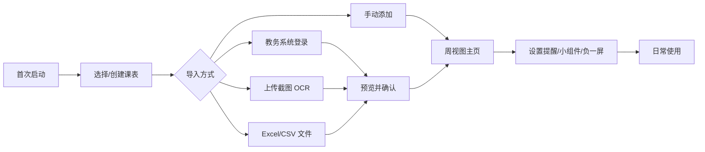
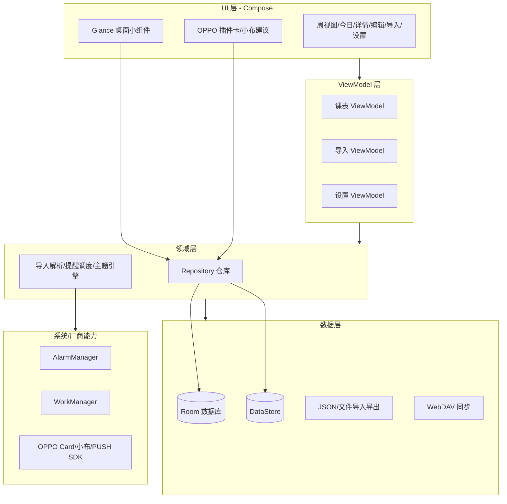
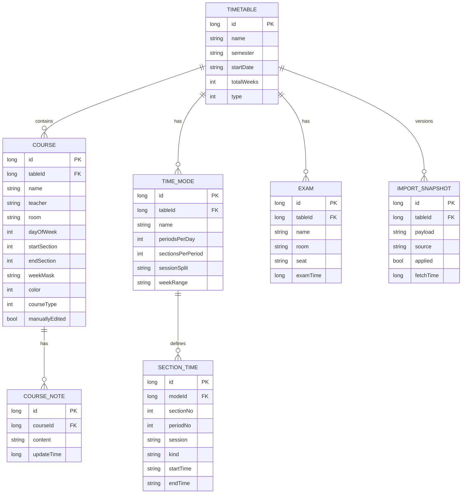
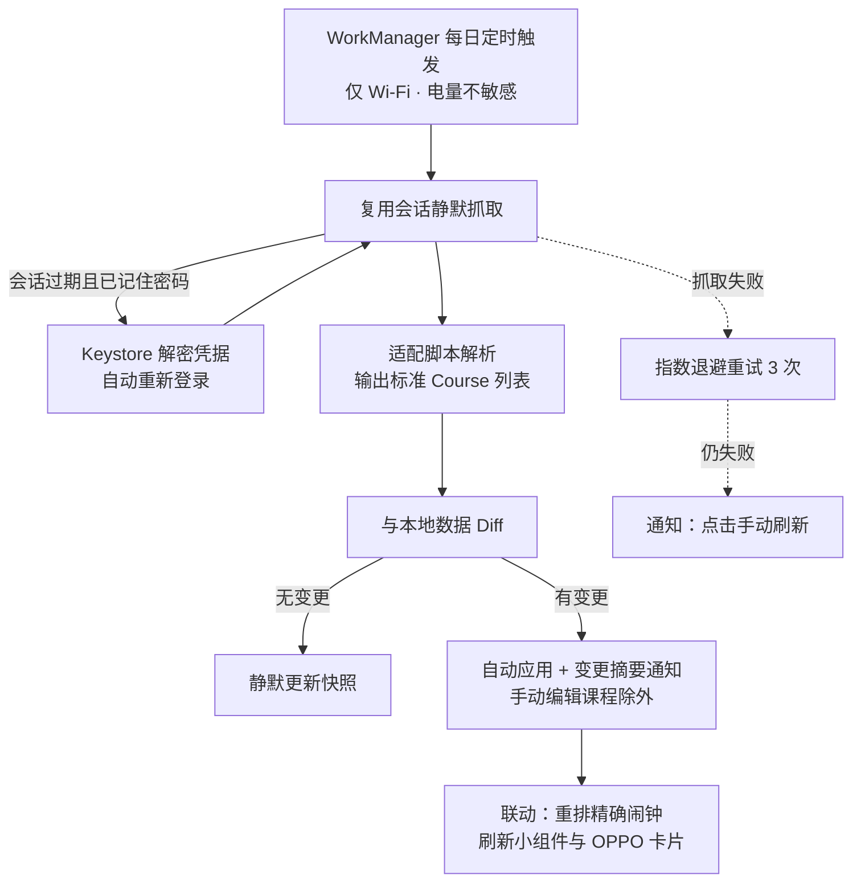
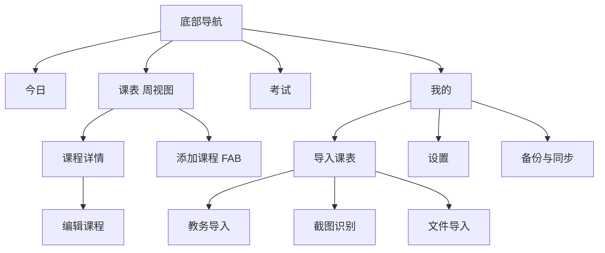

# 定制化课程表 App 技术方案

> 版本：v1.3　｜　编制日期：2026-10-12　｜　修订：v1.1 新增 4.9 / 4.10；v1.2 重写第 5 章多风格主题；v1.3 确定品牌命名、个人主体与自分发策略、首个适配目标（正方教务）　｜　适用平台：Android（ColorOS 深度适配），可扩展 iOS / 鸿蒙
>
> 说明：本文中 GitHub 项目的 Star 数、语言、协议均通过 GitHub API 于 2026-10-12 核实；OPPO 相关能力以 OPPO 开放平台官方文档为准，标注「需商务对接」的字段必须在正式合作后由 OPPO 提供，切勿凭空填写。

---

## 目录

1. [项目概述](#1-项目概述)
2. [开源项目与业界产品调研](#2-开源项目与业界产品调研)
3. [产品功能规划](#3-产品功能规划)
4. [技术栈与系统架构](#4-技术栈与系统架构)
5. [前端 UI 设计](#5-前端-ui-设计)
6. [OPPO 接口规范（重点）](#6-oppo-接口规范重点)
7. [其他厂商生态对比](#7-其他厂商生态对比)
8. [权限、隐私与合规](#8-权限隐私与合规)
9. [系统适配](#9-系统适配)
10. [开发排期与里程碑](#10-开发排期与里程碑)
11. [风险清单与应对](#11-风险清单与应对)
12. [未核实事项与补充路径](#12-未核实事项与补充路径)
13. [参考资料](#13-参考资料)

---

## 1. 项目概述

### 1.1 产品定位

一款面向中国高校学生的**本地优先（Local-first）、无广告、可深度定制**的课程表工具。核心体验是「打开即看、一键导入、多端提醒、个性外观」，并通过 OPPO 等厂商生态（负一屏卡片、小布建议、流体云、桌面小组件）让用户**无需打开 App 即可获取课程信息**。

### 1.2 目标用户

| 用户 | 核心诉求 |
| --- | --- |
| 本科生 / 研究生 | 教务一键导入、单双周、上课提醒、教室导航 |
| 多校区 / 多课表用户 | 多课表切换、作息时间自定义 |
| 教师 / 教培人员 | 排课、多班级管理 |
| 极客用户 | 主题、背景、字体、数据导出、WebDAV 同步 |

### 1.3 差异化策略

- **避开**超级课程表类「广告 + 社区」的臃肿路线，主打**轻、快、净**；
- **导入能力是护城河**：兼容主流教务系统 + 截图 OCR + WakeUp 生态口令；
- **厂商生态是放大器**：当前为个人主体，先以原生小组件 + 系统日历「零资质」接入，待具备企业主体后再接入 OPPO 负一屏 / 小布建议 / 流体云，并横向覆盖小米、华为、荣耀、vivo；
- **数据自主**：本地存储、可导出、可自托管同步（WebDAV），不锁定用户。

### 1.4 品牌、主体与分发策略（2026-10-12 确认）

| 项 | 决策 |
| --- | --- |
| 应用名称 | **纸间课表**（「纸间 / 指尖」双关，呼应默认主题「纸本暖白」） |
| 英文名 / 包名 | Paper Timetable ／ `com.zhijian.schedule` |
| Slogan | 指尖之间，一纸课表 |
| 图标方向 | 米白纸页 + 陶土色课程网格符号，圆角轮廓，深色模式反色 |
| 开发主体 | **个人开发者**（OPPO 插件卡 / 小布建议 / PUSH 均需企业认证，暂不可用，见第 6 章说明） |
| 分发方式 | **不上架应用商店**：GitHub Releases 分发 APK + 应用内检查更新（GitHub API）；无需 App 备案与商店审核 |
| 隐私政策 | 仍随包内置（自分发亦应提供），含教务访问、本地存储、第三方 SDK 披露 |

---

## 2. 开源项目与业界产品调研

### 2.1 GitHub 开源项目对比（数据已核实）

| 项目 | 仓库 | Stars | 语言 / 框架 | 协议 | 特点与可借鉴点 |
| --- | --- | --- | --- | --- | --- |
| **拾光课程表** | [ShiGuangSchedule/shiguangschedule](https://github.com/ShiGuangSchedule/shiguangschedule) | ~965 | Kotlin → Compose Multiplatform（2.x） | Apache-2.0 | **当前最值得参考的活跃项目**。今日/周次视图、多尺寸小组件、精确闹钟、上课自动静音、节假日同步、**WebDAV 同步**、三语；主 App 与适配仓库分离 |
| 拾光·适配仓库 | [ShiGuangSchedule/shiguang_warehouse](https://github.com/ShiGuangSchedule/shiguang_warehouse) | ~67 | JavaScript | MIT | **各高校教务适配脚本仓库**，证明「JS 适配脚本 + WebView」模式可行 |
| 拾光·测试器 | [ShiGuangSchedule/shiguang_Tester](https://github.com/ShiGuangSchedule/shiguang_Tester) | ~12 | JavaScript | MIT | 适配脚本在线调试工具，可直接参考 |
| **下节啥课** | [baoozak/timetable](https://github.com/baoozak/timetable) | ~64 | Vue 3 + uni-app | MIT | 模块化 Parser 适配**正方/URP/青果/强智/金智/南软/超星 7 大教务**；无 Widget，用常驻通知栏替代；高校索引来源 |
| **嘎嘎课程表** | [shuakami/timetable](https://github.com/shuakami/timetable) | ~13 | TypeScript + Capacitor | GPL-3.0 ⚠️ | **导入方式最全**：教务/Excel/CSV/JSON/ICS/AI Prompt→JSON；**写入系统日历**做同步底座；单节 Override 与常规规则分离、三方合并 |
| **旦挞 DanXi** | [DanXi-Dev/DanXi](https://github.com/DanXi-Dev/DanXi) | ~428 | Dart / Flutter | GPL-3.0 ⚠️ | 6 端覆盖（手机/桌面/Linux），复旦单校综合校园 App，证明 Flutter 跨端能力，但 Widget 弱、单校耦合 |
| **课枢 Keshu** | [huishingcheung/Keshu](https://github.com/huishingcheung/Keshu) | ~12 | Kotlin + Compose + Room | GPL-3.0 ⚠️ | 教科书级现代 Android 栈；Local-first，学分进度、考试安排、选课顾问；不存密码、排除云备份。**注意 GPL 传染** |
| **ClassIsland** | [ClassIsland/ClassIsland](https://github.com/ClassIsland/ClassIsland) | ~2860 | C# / WPF | GPL-3.0（插件 SDK 为 LGPL）⚠️ | 教室大屏课表，本批 Star 最高；插件化协议设计（LGPL）可参考；非手机 App |
| **TimetableView** | [tlaabs/TimetableView](https://github.com/tlaabs/TimetableView) | ~92 | Java | Apache-2.0 | 成熟的 Android 课程表自定义 View 库，可了解网格绘制思路（Compose 项目建议自绘） |
| ColorTimetable | [nei1e/ColorTimetable](https://github.com/nei1e/ColorTimetable) | ~160 | Vue / uni-app | MIT | 课程表 UI 组件（小程序方向），已停更，可参考网格组件 |
| SYLU-EOA | [kagg886/SYLU-Educational-Office-Accesser](https://github.com/kagg886/SYLU-Educational-Office-Accesser) | ~14 | Kotlin Multiplatform | MIT | 正方教务模拟登录 + 验证码处理样本，可导出 ICS |
| Timetable | [Potato-DiGua/Timetable](https://github.com/Potato-DiGua/Timetable) | ~21 | Java | MIT | 仿超级课程表，轻量，支持 Excel / 教务导入 |
| WakeUp 旧版（社区 fork） | [tKM9WsmQUaUgNttn3DGUsHkxG8/WakeupSchedule_Kotlin](https://github.com/tKM9WsmQUaUgNttn3DGUsHkxG8/WakeupSchedule_Kotlin) | ~31 | Kotlin | 未声明 | WakeUp 官方旧版（3.6.x）开源代码的社区镜像；**官方原始仓库已删除（404）**，仅作架构参考 |
| WakeUp 更早版 | [YZune/WakeUpSchedule](https://github.com/YZune/WakeUpSchedule) | ~29 | Java | 未声明 | 最早的 Java 版本（2018） |

> ⚠️ **GPL 商用提示**：GPL-3.0 具有强传染性，凡链接或派生 GPL 代码，整个 App 必须以 GPL-3.0 开源。闭源商用只能参考 Apache-2.0 / MIT 项目（拾光、下节啥课、TimetableView、ColorTimetable、SYLU-EOA），**不要直接拷贝 GPL 项目（嘎嘎、旦挞、课枢、ClassIsland）代码**。

> 补充：**WakeUp 课程表**（官网 [i.wakeup.fun](https://i.wakeup.fun/)）是当前国内最成功的课程表产品，支持 **1800+ 所高校**教务导入、4 种桌面小组件、多课表、云备份、Android/鸿蒙/iOS 全平台。其新版本已闭源商业化，应作为**产品对标对象**而非源码来源。

### 2.2 业界产品

| 产品 | 现状 | 评价 |
| --- | --- | --- |
| 超级课程表 | 老牌产品，功能全但广告多 | 已接入 ColorOS 16 小布建议 / 流体云，证明生态合作路径成立 |
| 课程格子 | 基本衰落 | 早期课表导入体验的参考 |
| 课查查 Classbuddy | 主打 3000+ 教务、AI 导入、多人协作 | 新势力，AI 解析与协作是方向 |
| 嘎嘎课程表 | 无广告，多源导入 + 写入系统日历 | 「不驻后台、依赖系统日历」的低功耗思路值得借鉴 |
| Nexio 课程表 | Compose 构建，WebView 脚本导入、AI 文本解析、WebDAV 同步 | 技术路线与本方案高度一致 |
| 厂商系统课程表 | ColorOS / MIUI / OriginOS / MagicOS 均自带 | 既是竞争对手也是分发渠道，选择「接入」而非「对抗」 |

### 2.3 调研结论

1. **技术上**：Kotlin + Compose + 本地数据库是主流；Flutter 可做但厂商卡片/小组件必须原生桥接。
2. **导入上**：「WebView 直连学校 + 社区 JS 适配脚本」是最合规、可扩展的方案（小米小爱课程表、拾光、WakeUp 均采用）。
3. **生态上**：桌面小组件是标配，负一屏 / 系统建议 / 流体云是差异化的关键。
4. **协议上**：优先参考 Apache-2.0 / MIT 项目；GPL 项目（课枢）仅用于学习，不能直接合入。

---

## 3. 产品功能规划

### 3.1 功能清单与优先级

| 模块 | MVP（P0） | P1 | P2 |
| --- | --- | --- | --- |
| 课表展示 | 周视图、单双周、当前周高亮、周末开关 | 日视图、多风格主题切换（5 套内置 + 动态取色）、节假日 / 调休标注 | 课表背景图、贴纸、自定义强调色 |
| 课程管理 | 增删改、课程颜色、教室 / 教师 | 多课表、学期管理 | 课程笔记、课程考勤 |
| 课表导入 | 手动、Excel/CSV、WakeUp 口令 | 教务系统导入、截图 OCR、教务自动同步（每日刷新 + 自动应用） | AI 自然语言解析 |
| 提醒 | 课前通知、精确闹钟 | 流体云倒计时、自动静音 | 语音播报、手表提醒 |
| 小组件 | 今日课程、本周课程 | 下一节、两日视图 | 自定义样式 |
| 同步备份 | 本地 JSON 导出导入 | WebDAV 同步 | 账号云同步 |
| 学业扩展 | — | 考试安排、倒计时 | 学分进度、作业 Todo、选课助手 |
| 生态接入 | 原生小组件、系统日历写入 | 应用内检查更新、OPPO 插件卡（需企业主体，远期） | 小布建议 / 流体云、小米 / 华为 / 荣耀 / vivo |

### 3.2 核心用户流程



---

## 4. 技术栈与系统架构

### 4.1 客户端方案对比与选型

| 维度 | Kotlin + Jetpack Compose（推荐） | Flutter | React Native |
| --- | --- | --- | --- |
| 课程表网格绘制 | Compose Canvas / Layout 灵活 | CustomPainter，可用 | 一般 |
| 桌面 App Widget | 原生 Glance / RemoteViews，最佳 | 需写原生桥接 | 需写原生桥接 |
| OPPO 插件卡 / 小布建议 | 原生 SDK 直接接入 | 需原生桥接，成本高 | 需原生桥接 |
| 精确闹钟 / 国产 ROM 适配 | 原生能力最完整 | 需桥接 | 需桥接 |
| iOS 覆盖 | 需另做 Swift | 一套代码 | 一套代码 |
| 团队要求 | Kotlin 经验 | Dart 经验 | JS/TS 经验 |

**结论：**

- **主方案（推荐）：Kotlin + Jetpack Compose**。课程表是重度 Android 本地工具，核心竞争力（小组件、负一屏、流体云、精确闹钟、国产 ROM 适配）全部依赖原生生态。
- **备选方案：Flutter**。仅当团队已具备 Dart 技术栈、且 iOS 与 Android 必须同期上线时选用；此时 Widget / 厂商卡片仍需 Android 原生层单独开发，工作量约增加 30%。

### 4.2 推荐技术栈总览

| 层次 | 技术选型 | 说明 |
| --- | --- | --- |
| 语言 / UI | Kotlin、Jetpack Compose、Material 3 | 单 Activity 架构 |
| 导航 | Navigation Compose | 配合底部导航栏 |
| 依赖注入 | Hilt | 标准方案 |
| 本地数据库 | Room（SQLite） | 结构化课表数据，Flow 响应式 |
| 键值存储 | DataStore (Preferences) | 设置项、轻量配置 |
| 主题引擎 | Design Token（ThemePreset）+ DataStore | 5 套内置风格 + 动态取色，详见 5.2 |
| 字体 | Noto Serif SC（子集化打包）+ 系统黑体 | 衬线标题仅用于「纸本暖白」风格 |
| 图标 | Material Symbols Rounded | 圆润线条，匹配多风格 |
| 图片加载 | Coil 3 | 课表背景图（P2） |
| 桌面小组件 | Glance（AppWidget） | 原生桌面部件 |
| 后台任务 | WorkManager | 课表刷新、备份、同步 |
| 定时提醒 | AlarmManager（精确闹钟）+ 通知渠道 | 见 4.7 |
| 网络 | OkHttp + Retrofit（如需） | 本地优先，MVP 可无网络 |
| 教务导入 | 系统 WebView + JS 注入（JavaScriptInterface） | 见 4.6 |
| OCR | ML Kit 文字识别（端上，中文） | 截图识别 |
| 文件解析 | Apache POI（xlsx）、opencsv、ical4j | Excel/CSV/ICS |
| 数据序列化 | kotlinx.serialization | JSON 导入导出 |
| 同步（P1） | WebDAV（sardine-android 等） | 坚果云 / 自建 NAS |
| 后端（P2，可选） | Kotlin Ktor 或 Spring Boot + PostgreSQL + Redis | 云账号、云同步 |

### 4.3 整体架构



### 4.4 工程结构（feature-first）

```
app/src/main/java/com/example/course/
├── MainActivity.kt
├── di/                         # Hilt 模块
├── core/
│   ├── data/                   # 数据库、DAO、DataStore
│   ├── model/                  # 领域模型
│   ├── repository/             # 仓库实现
│   └── util/
├── feature/
│   ├── schedule/               # 周视图（核心）
│   │   ├── ScheduleScreen.kt
│   │   ├── ScheduleViewModel.kt
│   │   └── components/         # 课程格子、时间轴
│   ├── today/                  # 今日页
│   ├── course_editor/          # 添加/编辑课程
│   ├── importer/               # 导入（教务/OCR/文件/口令）
│   ├── exam/                   # 考试安排
│   └── settings/
├── widget/                     # Glance 小组件
├── oplus/                      # OPPO 卡片/小布/PUSH
├── alarm/                      # 提醒调度
└── sync/                       # WebDAV
```

### 4.5 数据模型设计



**关键设计说明：**

- **两级节次模型**：大节（Period，教务原生排课单位）包含小节（Section，存储原子单位），`COURSE.startSection/endSection` 按小节存储；分场（上午 / 下午）由 `TIME_MODE.sessionSplit` 推导，详见 4.9；
- `TIME_MODE`（时间模式）：一个课表可挂多套作息、按 `weekRange` 周次区间生效，对应教务系统的「时间模式」下拉，支持不同校区 / 冬夏令时；
- `weekMask`：**位掩码字符串，长度 = `totalWeeks`**（如 20 周学期即 20 位），天然支持单双周、任意周；
- `dayOfWeek`：1~7（周一到周日）；
- `manuallyEdited`：用户手动编辑过的课程，自动同步时**永不被覆盖**（见 4.10）；
- `IMPORT_SNAPSHOT`：每次教务抓取的版本化快照（JSON + 时间戳），支持变更审计与回滚（见 4.10）；
- 课程颜色存色值（Int），主题切换时可选择保留或重新分配。

### 4.6 课表导入技术方案（核心难点）

| 方式 | 技术方案 | 合规性 |
| --- | --- | --- |
| **教务系统导入** | 内嵌**系统 WebView** 打开学校教务登录页，用户直连学校站点；登录后在课表页面**注入 JS 适配器脚本**抓取结构化数据，通过 `@JavascriptInterface` 回传原生解析 | 账号密码仅在用户设备与学校服务器之间传递，**不经开发者服务器**，合规性最好 |
| 适配脚本生态 | 参考小米小爱课程表、拾光 `shiguang_warehouse`：由社区为每所学校编写 JS 脚本（含 `getSchedule()` 等约定函数），App 内置脚本仓库并支持更新 | 脚本开源、可审计 |
| **截图 OCR** | ML Kit 端上文字识别 → 自研网格 / 文本解析（按星期、节次、周次规则还原） | 完全离线，无隐私风险 |
| **Excel / CSV** | Apache POI 解析 xlsx（旧版 xls 注意 jxl 兼容性）；CSV 约定表头：课程名/星期/开始节/结束节/老师/地点/周数 | 本地解析 |
| **JSON / 口令** | 兼容 WakeUp 分享文本与 JSON 课程文件，降低用户迁移成本 | — |
| **ICS 日历** | ical4j 解析标准日历文件 | 通用标准 |
| **AI 解析（P2）** | 大模型将非结构化文本（教学通知、培养方案）转为标准 JSON，本地预览后导入 | 需用户确认，结果可校验 |

> **首个适配目标（已确认）**：**正方教务系统**——东莞职业技术学院 `jw.dgpt.edu.cn`（`/jsxsd/` 新版学生端）。可参考拾光 `shiguang_warehouse` 的正方脚本（MIT）与 SYLU-EOA 的正方模拟登录 + 验证码处理样本（MIT）；课表数据页通常为 `POST /jsxsd/xskb/xskbList.do`（依赖登录 Cookie），天然支持 4.10 的「HTTP 重放优先」策略。注意：正方部署多含登录验证码，「记住密码」自动重登不可行时按 4.10 降级为通知手动刷新。

**导入统一流程：** 原始数据 → 解析为标准 `Course` 列表 → **预览页（高亮新增/变更/冲突）** → 用户确认 → 落库；重复导入时按 `课程名+星期+节次` 去重，保留用户手动修改。

### 4.7 提醒与后台任务

- **精确闹钟**：使用 `AlarmManager.setExactAndAllowWhileIdle()`，确保 Doze 模式下准时；
- **权限**：Android 12+ 需 `SCHEDULE_EXACT_ALARM` / `USE_EXACT_ALARM`（Android 13+ 对非日历/闹钟类应用收紧，需引导用户到设置授权）；
- **通知渠道**：按「上课提醒 / 考试提醒 / 同步」分渠道，支持静默与重要级；
- **WorkManager**：负责周期性教务课表自动同步（见 4.10）、WebDAV 备份、节假日数据更新；
- **自动静音（P1）**：上课时段切换通知 / 勿扰模式（需 `ACCESS_NOTIFICATION_POLICY`），下课恢复；
- **国产 ROM 适配**：首次使用引导用户开启「自启动 / 后台运行 / 电池不优化」，保证提醒与小组件刷新。

### 4.8 后端与同步策略

- **MVP 阶段：无后端**。所有数据本地存储，零服务器成本、零隐私风险。
- **P1 同步：WebDAV**。用户自行配置坚果云 / NAS，App 读写加密的 JSON 备份，实现多设备同步与换机迁移。
- **P2 可选后端**：当需要账号体系、课表分享、AI 解析时，再建设：
  - 框架：Kotlin Ktor（轻量）或 Spring Boot（团队熟悉 Java 时）；
  - 数据库：PostgreSQL；缓存：Redis；
  - 部署：容器化（Docker）+ 云厂商（腾讯云 / 阿里云）；
  - 鉴权：手机号 + 验证码 或 OAuth，JWT 会话；
  - 云同步采用「本地数据库 + 增量同步」（可参考 PowerSync 思路）。

### 4.9 课程表格规范（两级节次模型与上/下午分场）

> 产品决策（2026-10-12 确认）：每日 6 大节，分场为**上午（大节①–②，08:20–11:45）+ 下午（大节③–⑥，14:20–21:35，含晚间）**；教务自动同步每日 1 次、变更自动应用、提供可选「记住密码」实现全自动（见 4.10）。

**① 节次层级**

| 层级 | 单位 | 说明 |
| --- | --- | --- |
| 分场 Session | 上午 / 下午 | 展示分组，由 `periodNo` 按 `sessionSplit`（本校 2+4）推导，周视图场间以分隔线区分 |
| 大节 Period | 大节①–⑥ | 教务系统原生排课单位（每大节 95 分钟） |
| 小节 Section | 小节 1–12 | **存储与排课的原子单位**，`COURSE.startSection/endSection` 按小节存储 |

- 换算规则：**大节 n = 小节 2n-1 ~ 2n**；教务导入的「大节」自动展开为小节区间；手动添加课程时支持「按大节 / 按小节」两种粒度；
- 兼容性：按小节排课的学校（无大节概念）设 `sectionsPerPeriod = 1` 即可，模型无需改动。

**② 默认作息（小节时间为 45+5+45 推导值，用户可微调）**

| 大节 | 时间 | 小节 | 分场 |
| --- | --- | --- | --- |
| ① | 08:20–09:55 | 1–2 | 上午 |
| ② | 10:10–11:45 | 3–4 | 上午 |
| ③ | 14:20–15:55 | 5–6 | 下午 |
| ④ | 16:05–17:40 | 7–8 | 下午 |
| ⑤ | 18:20–19:55 | 9–10 | 下午 |
| ⑥ | 20:00–21:35 | 11–12 | 下午 |

**③ 标准 JSON 结构（导入 / 导出 / 同步 / 快照共用）**

```json
{
  "timeMode": {
    "name": "默认节次模式",
    "periodsPerDay": 6,
    "sectionsPerPeriod": 2,
    "sessions": [
      { "name": "上午", "periods": [1, 2] },
      { "name": "下午", "periods": [3, 6] }
    ],
    "sections": [
      { "no": 1, "period": 1, "session": "AM", "start": "08:20", "end": "09:05" },
      { "no": 2, "period": 1, "session": "AM", "start": "09:10", "end": "09:55" }
    ]
  },
  "course": {
    "name": "包装材料与检验",
    "dayOfWeek": 1,
    "startSection": 1,
    "endSection": 4,
    "weekMask": "11111111110000000000",
    "manuallyEdited": false
  }
}
```

> 示例说明：周一「包装材料与检验」占大节①②，展开为小节 1–4——这正是两级模型的意义；`weekMask` 长度 = 学期总周数（本学期 20 周），「第 7 周」由 `startDate + 6×7` 自动定位。

### 4.10 教务课表自动同步（防课程变更导致数据过期）

**目标**：教务处调课 / 换教室 / 停课后，App 内课表自动跟进，避免用户按旧课表走错教室。



**设计要点：**

| 环节 | 方案 |
| --- | --- |
| 调度 | 默认**每日 1 次**（可调：每 12h / 每周 / 关闭），建议凌晨执行；打开 App 时距上次成功抓取 > 6h 触发兜底刷新；超过 `totalWeeks` 自动停用本学期任务；约束：Wi-Fi 可选、电量不敏感 |
| 会话 | 默认仅复用 WebView CookieManager 持久化的会话（Keystore 加密）；开启「记住密码」后凭据加密存储，会话过期可**自动重登**，实现完全无人值守 |
| 抓取 | 优先 **HTTP 重放**（快、省电，由适配脚本声明支持）；不支持的学校用离屏 WebView 注入执行；与手动导入**共用同一套适配脚本**，保证解析结果一致 |
| Diff | 对比 key = `课程名 + dayOfWeek + 小节区间`；变更分三类：新增 / 取消 / 属性变更（教室、教师、周次）；每次抓取写入 `IMPORT_SNAPSHOT` 快照（版本化、可回滚、可审计） |
| 自动应用 | 变更**自动应用并推送变更摘要通知**（如「大学英语 教室改为 教305」）；`manuallyEdited = true` 的课程**永不被覆盖**，冲突单独列出供用户裁决；应用后联动重排当日 / 次日精确闹钟、刷新 Glance 小组件与 OPPO 卡片 |
| 失败降级 | 指数退避重试 3 次 → 通知「课表刷新失败，点击处理」；未记住密码且会话过期 → 引导重新登录；ColorOS 需引导「自启动 + 电池不优化」白名单，否则后台任务会被冻结 |
| 合规 | 「记住密码」默认关闭、开启时单独弹窗明示风险；密码**永不上传、永不写入日志**；隐私政策披露后台访问教务的行为与数据存储方式（见 8.2 / 11） |

---

## 5. 前端 UI 设计

### 5.1 设计理念：一套设计系统，多套可切换风格

以 **Material 3 组件为骨架**（状态逻辑、无障碍、交互规范），视觉层（色彩 / 字体 / 形状 / 课块样式）**全部 Token 化**，形成「一套代码 + N 套风格」的主题体系：

- **默认风格「纸本暖白」**：Claude 式温暖极简（米白纸感 + 衬线标题 + 陶土强调色 + hairline 边框），与系统课表 / 竞品的冷白 Material 风形成一眼可辨的差异化，契合「轻、快、净」定位；
- **内置 5 套风格**随时切换，覆盖不同审美取向，参考 WakeUp 皮肤、拾光动态取色、超级课程表多彩风等业界做法；
- 切换零成本：课块渲染规则统一（透明填充 + 左色条），风格差异只体现在 Token 上。

### 5.2 设计规范

**① Design Token 体系**

```kotlin
data class ThemePreset(
    val id: String,               // "paper" / "dynamic" / "minimal" / "amoled" / "candy"
    val name: String,             // 显示名
    val light: CourseColors,      // bg / surface / text / textMuted / border / accent
    val dark: CourseColors,       // 每套风格独立的暗色映射
    val coursePalette: List<Int>, // 课程色板（随风格饱和度调整，亮暗各校验对比度）
    val blockStyle: BlockStyle,   // 填充透明度 / 左色条宽 / 课块圆角
    val typography: TypePreset,   // 标题是否衬线、字号规格
    val radius: RadiusPreset      // 课块 / 卡片 / 弹层圆角
)
```

**② 内置风格清单（业界做法参考）**

| # | 风格 | 定位 | 业界参考 | 关键特征 |
| --- | --- | --- | --- | --- |
| 1 | 纸本暖白（默认） | 温暖极简 | Claude / 阅读类 App | 米白 `#FAF6EF` + 陶土 `#D97757` + 衬线标题 + hairline 边框 |
| 2 | 动态取色 | 跟随系统 | 拾光、Material You（Android 12+） | 从壁纸派生色板，与 OPPO 生态最协调 |
| 3 | 清爽极简 | iOS 风 | Apple 日历 / Things | 纯白底 + 系统蓝 + 无衬线 + 大圆角卡片 |
| 4 | 墨夜纯黑 | AMOLED / 夜间 | 各类工具 App 暗色 | 纯黑 `#000000` + 高对比课块，OLED 省电 |
| 5 | 多彩活泼 | 年轻向 | 超级课程表、WakeUp 皮肤 | 高饱和糖果色块，视觉最跳 |

**③ 默认风格「纸本暖白」Token 详表**

| Token | 亮色 | 暗色 |
| --- | --- | --- |
| 背景 | `#FAF6EF` 米白 | `#211D19` 暖黑（非纯黑） |
| 卡片面 | `#FFFFFF` | `#2A2620` |
| 主文字 | `#3D3929` 暖炭 | `#E8E2D5` |
| 次要文字 | `#8A8273` | `#A39B8B` |
| 边框 | `#E7DFD2`（1dp hairline） | `#3A342C` |
| 强调色 | `#D97757` 陶土（FAB / 当前周 / 选中态） | 同色 |
| 圆角 | 课块 10dp / 卡片 16dp / 弹层 20dp | — |

**④ 课程色板与课块渲染**

- 纸感低饱和色板（8 色起步，可扩至 12）：`#C4704F` 陶土红、`#C99A3D` 琥珀、`#7D9B5A` 苔绿、`#4E9B8B` 青瓷、`#5B8DB8` 雾蓝、`#9B7DB8` 藤紫、`#C2848D` 豆沙、`#8A8F98` 暖灰蓝；
- 活泼风高饱和色板：`#3A7DFF`、`#2BB673`、`#F59E0B`、`#EF4444`、`#8B5CF6`、`#06B6D4` 等；其余风格各自提供色板，均需在亮 / 暗两种底色下通过对比度校验；
- 课块统一渲染规则：**透明填充（亮 12~16% / 暗 24%）+ 3dp 左色条 + 主题文字色**——一套代码适配全部风格。

**⑤ 字体**

- 「纸本暖白」：标题 Noto Serif SC（**子集化打包**，常用 3500 字 ≈ 1.5~2MB），正文系统黑体；其余风格标题使用无衬线；
- 规格：课表课程名 12~13sp、时间轴 11sp、页面标题 20sp、今日大标题 28sp；
- 支持用户自定义字体大小（P2）。

**⑥ 间距与形状**

- 基础间距单位 4dp；课程格子内边距 6dp、格子间距 2~3dp；
- 圆角随风格 Token（见 ③），触控目标最小 48dp。

**⑦ 动效**

- 周次滑动：水平分页 + 课程块淡入；
- 课程详情：共享元素（Shared Element）展开；
- 上下课状态：颜色 / 进度条平滑过渡；转场整体「慢而柔」（约 300ms、低位移）；
- 遵循系统「移除动画」无障碍设置。

**⑧ 主题切换机制**

- Token 经 `CompositionLocal` 注入，`MaterialTheme` 外再包一层 `CourseTheme(preset)`，切换即全 App 生效；
- 设置页提供**即时预览**（横滑风格卡片），选择持久化到 DataStore；深色跟随系统或手动锁定；
- 小组件（Glance）与 OPPO 卡片仅同步**色板 + 圆角** Token 子集（RemoteViews 不支持自定义字体）；
- P2 开放自定义强调色、课表背景图（对应原「皮肤」能力）。

### 5.3 信息架构与导航



### 5.4 核心页面线框图

**① 周视图主页（核心）**

```
┌───────────────────────────────────────────┐
│  10月12日 星期一            第 6周 ▾  ⚙   │
│  今天                          [非本周]    │
├──────┬─────┬─────┬─────┬─────┬─────┬─────┤
│ 节次 │ 周一 │ 周二 │ 周三 │ 周四 │ 周五 │ 周六│
├──────┼─────┼─────┼─────┼─────┼─────┼─────┤
│  1   │     │高数 │     │     │英语 │     │
│  2   │    │08:00│     │     │08:00│     │
│      │     │教101│     │     │教305│     │
├──────┼─────┼─────┼─────┼─────┼─────┼─────┤
│  3   │ 程序设计基础      │     │     │     │
│  4   │ 实验楼 A401       │     │ 体育 │     │
├──────┼─────┼─────┼─────┼─────┼─────┼─────┤
│ ...  │     │     │     │     │     │     │
└──────┴─────┴─────┴─────┴─────┴─────┴─────┘
        （网格按 上午/下午 分场渲染，场间以分隔线区分；当前时间红线指示当前节）
                                  [ ＋ FAB ]
```

**② 今日页**

```
┌──────────────────────────────────┐
│         今天 · 周一               │
│         第 6 周                   │
├──────────────────────────────────┤
│  ┌────────────────────────────┐  │
│  │  正在上课                    │  │
│  │  程序设计基础               │  │
│  │  实验楼 A401   还剩 38 分钟  │  │
│  └────────────────────────────┘  │
│  下一节                           │
│  ┌────────────────────────────┐  │
│  │ 14:00  大学英语             │  │
│  │        教 305              │  │
│  └────────────────────────────┘  │
│  今日剩余 2 节                    │
└──────────────────────────────────┘
```

**③ 添加 / 编辑课程**

```
┌──────────────────────────────────┐
│  添加课程                    保存  │
├──────────────────────────────────┤
│  课程名称  [____________]        │
│  上课教室  [____________]        │
│  授课教师  [____________]        │
│  星期      [ 周一 ▾ ]             │
│  节次      [ 第 3 节 ~ 第 4 节 ]  │
│  周次      [ 1-16周 ] [单][双]    │
│  颜色      ● ● ● ● ● ● ●         │
│  备注      [____________]        │
└──────────────────────────────────┘
```

**④ 导入向导**

```
┌──────────────────────────────────┐
│  导入课表                         │
├──────────────────────────────────┤
│  🏫 教务系统导入（推荐）          │
│  📷 拍照 / 相册识别               │
│  📄 Excel / CSV 文件              │
│  🔗 粘贴课表口令 / JSON           │
│  📅 日历 (.ics) 文件              │
└──────────────────────────────────┘
```

### 5.5 桌面小组件设计

| 部件 | 尺寸 | 内容 |
| --- | --- | --- |
| 今日课程 | 4×2 / 4×3 | 当天剩余课程、当前节进度 |
| 下一节 | 2×2 | 节次、课程名、教室、倒计时 |
| 本周课程 | 4×4 | 迷你周视图网格 |
| 两日视图 | 4×2 | 今天 + 明天 |

设计要点：色板与圆角读取当前主题 Token 子集（RemoteViews 不支持自定义字体）、深色自适应、点击进入对应课程详情、支持多课表选择、按系统刷新策略（建议结合闹钟主动刷新，避免内容过期）。

### 5.6 通知与系统建议样式

- 课前通知：`15 分钟后 · 大学英语 · 教 305`，附「查看路线 / 静默」操作；
- 流体云（ColorOS 14+）：上课前以胶囊显示课程名 + 倒计时，点击直达 App；
- 锁屏 / AOD：展示下一节关键信息（依赖小布建议，见 6.3）。

### 5.7 高保真 UI 设计稿

以下为关键界面设计稿（图片位于同目录 `assets/` 文件夹）；线框布局对各风格通用，实际配色 / 字体 / 圆角由所选主题 Token 实时渲染：

**① 周视图主页**：时间轴 + 彩色课程块、当前星期高亮、周次切换、底部三 Tab、右下 FAB


**② 添加 / 编辑课程**：表单式录入，节次、周次、颜色一目了然


**③ 桌面小组件**：今日课程 / 下一节，深色自适应


---

## 6. OPPO 接口规范（重点）

> **当前状态（2026-10-12 确认）**：开发主体为个人，本章所有能力（负一屏插件卡、小布建议 / 流体云、OPPO PUSH）均需**企业开发者认证**，现阶段不可用，整章保留为**远期路线**（具备企业主体后启用）。MVP 的厂商触达替代方案：**原生 Glance 小组件（5.5）+ 系统日历写入（6.5，ColorOS 私有库）+ 本地精确闹钟（4.7）**——三者均零资质、零商务依赖。

### 6.1 OPPO 生态能力地图

OPPO（含一加、realme，均运行 ColorOS）面向开发者的课程表相关能力分为三层，入口均在 **OPPO 开放平台 [open.oppomobile.com](https://open.oppomobile.com/)**：

| 能力 | 用途 | 呈现入口 | 文档位置 |
| --- | --- | --- | --- |
| **负一屏卡片（Card）** | 自定义课程卡片，能力最强 | 负一屏、桌面 | 文档中心 → 智慧服务 → 负一屏 |
| **小布建议 / 流体云（泛在服务 · 潘塔纳尔）** | 情境化课程提醒、实时活动 | 流体云、锁屏、状态栏、桌面、负一屏 | 文档中心 → 智慧服务 → 小布建议 / 流体云 |
| **OPPO PUSH** | 服务端消息推送（课表更新、营销） | 通知栏 | 开发服务 → 推送服务 |

> 前置条件：均需注册 **OPPO 企业开发者账号**、完成实名认证并创建应用（管理中心 → 应用服务平台 → 移动应用列表 → 创建应用）。

### 6.2 负一屏卡片：插件卡接入

#### 6.2.1 三种卡片类型对比

| 类型 | 技术形态 | 适用 |
| --- | --- | --- |
| 快应用卡片 | 快应用开发，上传快应用联盟 | 已有快应用、追求轻量 |
| **插件卡片（推荐）** | Android 原生 SDK + DSL 布局 | 能力最强，支持动画、自定义控件、视频，桌面/负一屏通用 |
| 安卓原生卡 | 标准 AppWidget | 最简单，能力受限 |

插件卡相比原生 AppWidget 的优势：**支持动画、自定义控件、视频、更灵活的属性定制、更完善的生命周期，且可同时添加到桌面和负一屏**。

#### 6.2.2 接入流程


1. 开通 Card 服务：管理中心 → 应用服务平台 → 开发服务 → **Card**；
2. 选择应用 → **申请授权码**（多签名应用需对每个签名分别申请）；
3. 联系商务协调对接人，审批卡片配置（卡片标题、卡片组名称、尺寸、包名），获取 **`card_type`（卡片唯一标识，必须申请后使用）**；
4. 正式上架前需安装 AssistantScreen 的 oapm 包并切换测试环境，卡片才会显示。

#### 6.2.3 授权码配置（AndroidManifest.xml）

```xml
<!-- 单签名 -->
<application>
    <meta-data
        android:name="com.oplus.ocs.card.AUTH_CODE"
        android:value="替换成你的auth_code" />
</application>

<!-- 多签名 -->
<meta-data
    android:name="com.oplus.ocs.card.AUTH_CODE"
    android:value="auth_code1;auth_code2" />
```

#### 6.2.4 声明卡片 Provider

```xml
<provider
    android:name=".oplus.ScheduleCardProvider"
    android:authorities="com.example.course.card"
    android:enabled="true"
    android:exported="true">
    <intent-filter>
        <!-- 固定字段，用于查询组件 -->
        <action android:name="android.appcard.action.APPCARD_UPDATE" />
    </intent-filter>
    <meta-data
        android:name="android.card.provider"
        android:resource="@xml/schedule_appcard" />
</provider>
```

卡片配置文件 `res/xml/schedule_appcard.xml`：

```xml
<card-provider
    xmlns:app="http://schemas.android.com/apk/res-auto"
    app:oplus_card_type="5"                       <!-- 必配，申请后由官方分配 -->
    app:oplus_card_protocol="JSON"                <!-- 必配，通信协议 -->
    app:oplus_card_name="@string/card_name"       <!-- 必配，卡片名称 -->
    app:previewImage="@drawable/card_preview"     <!-- 必配，商店预览图 -->
    app:groupTitle="@string/card_group_name"      <!-- 必配，卡片组标题 -->
    app:groupImage="@drawable/card_group_icon"    <!-- 必配，卡片组图标 36dp -->
    app:oplus_card_size="two2four" />             <!-- 选配：two2two / two2four / four2four -->
```

卡片尺寸：

| 尺寸标识 | 规格 |
| --- | --- |
| `two2two` | 小卡 156×156 dp |
| `two2four` | 中卡 324×156 dp |
| `four2four` | 大卡 324×324 dp |

#### 6.2.5 配置依赖

```kotlin
// 卡片接入 SDK（具体版本号以官方文档「点击查看」为准）
implementation("com.oplus.card.widget:cardwidget:xxx")
// 智能引擎助手（含自定义 View 时需与 UI 引擎对齐版本）
implementation("com.oplus.smartengine:smartenginehelper:xxx")
```

#### 6.2.6 接口实现

只需实现两个核心类：

**① `AppCardWidgetProvider`**（本质是 ContentProvider，处理卡片生命周期与通信）：

```kotlin
class ScheduleCardProvider : AppCardWidgetProvider() {

    // 必配：返回卡片布局名（assets 下的 json 文件）
    override fun getCardLayoutName(widgetCode: String): String {
        return when (widgetCode.getCardType()) {
            0 -> "today_card.json"
            else -> "week_card.json"
        }
    }

    // 卡片曝光（可见）时回调，通常在此推送数据
    override fun onResume(context: Context, widgetCode: String) {
        val data = repository.getTodayCardData()          // 1. 准备业务数据
        CardWidgetAction.postUpdateCommand(               // 2. 推送刷新
            context,
            ScheduleDataPack(data),
            widgetCode
        )
    }

    // 卡片被订阅 / 取消订阅
    override fun subscribed(context: Context, widgetCode: String) {}
    override fun unSubscribed(context: Context, widgetCode: String) {}

    // 监听已订阅卡片列表变化
    override fun onCardObserve(context: Context, widgetCodes: List<String>) {}

    // 渲染失败时可重新发送数据
    override fun onRenderFail(context: Context, widgetCode: String) {}
}
```

主要 API：

| API | 说明 |
| --- | --- |
| `getCardLayoutName(widgetCode)` | 必配，返回布局 json 名 |
| `onResume / subscribed / unSubscribed` | 生命周期回调 |
| `postUpdateCommand(data, widgetCode)` | 推送卡片数据 |
| `switchLayoutCommand(widgetCode, layoutName)` | 切换整体布局 |
| `onCardObserve(...)` | 监听订阅列表变化 |
| `onRenderFail(...)` | 渲染失败回调 |

> `widgetCode` 可解析出 `getCardType()`（卡片类型）、`getCardId()`（重复添加时递增）；设置页跳转 Bundle 还会携带 `hostId`（0=负一屏，1=桌面）。

**② `BaseDataPack`**（负责数据填充）：

```kotlin
class ScheduleDataPack(private val data: CardData) : BaseDataPack() {
    override fun onPack(coder: DSLCoder): Boolean {
        coder.setTextViewText("course_name", data.courseName)
        coder.setTextViewText("course_room", data.room)
        coder.setTextViewText("countdown", data.countdownText)
        coder.setImageViewResource("course_icon", data.iconId.toString())
        return true
    }
}
```

#### 6.2.7 卡片布局（DSL）

- 卡片布局通过 **DSL/JSON** 描述，预置到 `assets` 目录，由 OPPO 卡片 UI 引擎解析为原生控件；
- 布局指导文档：《卡片引擎接入指导》（官方文档内提供，地址 `odocs.myoas.com`，需在对接环境访问）；
- 注意：**不要固定父布局大小**（使用 `match_parent`）；负一屏已统一处理卡片外边距与固定尺寸，无需重复设置。

#### 6.2.8 刷新机制

- **场景一（被动）**：卡片可见时 `onResume` 回调，满足官方配置的「支持主动刷新 + 最小刷新间隔」时，卡片服务会强制拉起 App 推送数据；
- **场景二（主动）**：课程数据变化时直接调用 `CardWidgetAction.postUpdateCommand()`；
- 强刷新需求建议在卡片上提供「刷新」按钮（遵循官方刷新规则）。

#### 6.2.9 注意事项

- 资源混淆：仅在 json 中引用的资源 release 时可能被误删，需在 ProGuard / `res/raw/keep.xml` 中 keep；
- 本地资源不显示：检查 json 中 `package` 字段是否等于自身 `applicationId`；
- 上架前必须覆盖折叠屏、暗色模式、多桌面布局（3×5 ~ 5×6）测试；
- Android O/P 兼容需注册拉活服务 `com.oplus.channel.client.service.PullAliveService`。

### 6.3 小布建议 / 流体云：泛在服务（潘塔纳尔）

> **关键澄清（务必先读）**：ColorOS **不存在公开的、字段级的「课程表数据同步 SDK」**。WakeUp、超级课程表之所以能在「小布建议 → 办公学习 → 课程提醒」中作为**服务提供方**出现，走的是 OPPO 小布建议团队与头部 App **逐一商务对接的白名单合作（NDA，协议不公开）**，没有自助注册入口。
>
> 对第三方而言，公开的路径是：① 按下方**泛在服务框架**自助开发 `.upk` 卡片（能力在陆续开放）；② 联系 OPPO 商务申请进入「小布建议-课程提醒」场景白名单（需接受按 CTR 放量的冷启动考核）。
>
> 官方合作流程（《智慧服务合作策略》PDF）：商务建联 → 准入评估 → 卡片设计方案 → 开发 → 测试报告 → 上传开发包 → 内部定投 → 冷启动放量（按 UVCTR/PVCTR、eCPM 决定推荐位）。

#### 6.3.1 概念

泛在服务是 OPPO 潘塔纳尔（Pantanal）系统提供的服务形态，使用 **JS + CSS + OML 模板**开发，构建产物为 **`.upk`** 包，由「服务治理框架（UMS）」负责发现、安装、运行与分发。

四大特征：**情境感知、轻量化开发（一次开发多入口）、自然交互、智能流转**。

卡片承载三类功能：

| 类型 | 说明 | 主要入口 |
| --- | --- | --- |
| **实时活动类** | 确定、实时的信息（如上课倒计时） | **流体云** |
| 推荐类 | 基于行为预测的推荐 | 桌面、负一屏 |
| 订阅类 | 长期关注的信息 | 桌面、负一屏 |

卡片可呈现于：桌面、负一屏、AOD、锁屏、状态栏、通知中心、折叠外屏。

#### 6.3.2 开发方式

- 工具：**潘塔纳尔开发者 IDE**（支持项目创建、模板、编辑、预览、打包签名）或**潘塔纳尔服务搭建平台**（图形化拖拽，无码化）；
- 工程结构：服务主体（JS 逻辑 + CSS + OML 模板）、库文件、资源文件、配置文件 `config.json`；
- 发布：通过「潘塔纳尔服务库」发布；
- 情境触发：通过配置**意图（intent）**关联用户场景，例如：

```json
{
  "intent": {
    "action": ["pantanal.intent.xxx.COURSE_REMIND"],
    "domain": "education"
  }
}
```

#### 6.3.3 意图共享接口（强调信息模板）

课程提醒可通过「意图共享」向系统推送卡片，核心数据单元为 **`IntelligentIntent`**，字段规范如下：

| 字段 | 类型 | 必填 | 说明 |
| --- | --- | --- | --- |
| `intentName` | String | 是 | 意图名称；调测环境为固定示例值，**正式环境由 OPPO 提供** |
| `identifier` | String | 是 | 单次共享唯一标识（UUID / 时间戳） |
| `timestamp` | Long | 是 | 系统时间戳（毫秒） |
| `serviceId` | JSON | 是 | 卡片 ID，每个 ID 对应一张卡片；调测示例 `{"fluidCloud":"999900003","launcher":"999800003"}`，**正式值由 OPPO 提供** |
| `intentAction.actionStatus` | Int | 是 | **0 创卡 / 1 刷新 / 2 销卡** |
| `intentEntity.entityName` | String | 是 | 垂域名称（教育 / 课程垂域，正式值由 OPPO 提供） |
| `intentEntity.entityId` | String | 是 | 实体唯一标识（如课程 ID） |
| `intentEntity.milestone` | JSON | 是 | 里程碑状态 `{ "code": Int, "text": String }`，如「待上课 / 上课中 / 已下课」，码值以垂域文档为准 |
| `primary` | JSON | 否 | 卡片主要信息：`topLeftImg/Text`、`topRightImg/Text`、左右按钮、图标等 |
| `secondaryData` | JSON | 否 | 扩展区：`{ "type": "STRESS_TEXT", "textInfo": "..." }` |

数据示例：

```json
{
  "intentName": "Example.StressText",
  "identifier": "d71ebd31-1987-7b12-ecdb-6c4fe96b068e",
  "timestamp": 1729485000989,
  "serviceId": {
    "launcher": "999800003",
    "fluidCloud": "999900003"
  },
  "intentAction": { "actionStatus": 0 },
  "intentEntity": {
    "entityName": "education.course",
    "entityId": "course_20261012_03",
    "milestone": { "code": 1, "text": "15 分钟后上课" }
  },
  "primary": {
    "topLeftText": "大学英语",
    "topRightText": "教 305"
  },
  "secondaryData": {
    "type": "STRESS_TEXT",
    "textInfo": "14:00 开始 · 还剩 15 分钟"
  }
}
```

> 行为说明：同一 `entityId` 下 `actionStatus=0/1` 时未创卡则创卡、已创卡则刷新，并依据 `milestone` 设置延时销卡；`actionStatus=2` 立即销卡。

#### 6.3.4 课程场景落地建议

- **课前 15 分钟**：创卡（actionStatus=0），流体云显示课程名 + 教室 + 倒计时；
- **上课中**：刷新（actionStatus=1），里程碑变为「上课中」，显示剩余时间；
- **下课后**：销卡（actionStatus=2）；
- 上述 `intentName`、`serviceId`、教育垂域 `entityName`、`milestone` 码值均属**需商务对接后由 OPPO 提供**的内容，本文示例仅为调测模板，不可直接用于正式环境。

### 6.4 OPPO PUSH

#### 6.4.1 接入流程

1. 使用企业开发者账号登录 → 管理中心 → 应用 → 开发服务 → **推送服务**，申请权限；
2. 开通后在推送运营平台获取密钥：
   - **AppKey + AppSecret**：客户端 SDK 注册使用；
   - **MasterSecret**：服务端 API 调用使用（务必保密，不下发客户端）；
3. 集成客户端 SDK，应用首次启动注册并获取 **RegistrationID**；
4. 服务端通过 API 或 **opush-server-sdk** 按 RegistrationID 下发消息。

#### 6.4.2 关键概念

| 概念 | 说明 |
| --- | --- |
| RegistrationID | 设备上该应用的推送标识；首次启动注册生成，仅在刷机、还原手机、卸载时失效 |
| 通知栏消息 | 系统通知栏展示，含标题、子标题（≤10 字符）、正文（标准样式 ≤50 字符）、样式等 |
| 透传消息 | 由 App 自行处理 |
| **消息分类** | 下发时携带 `category`、`notify_level` 字段，需按新消息分类流程接入（影响通知展示与送达） |
| 私信 | 需先完成正式推送申请，模板审核后按模板 ID 下发 |

#### 6.4.3 服务端 API（已核实到的层面）

**请求地址：**

| 环境 | URL |
| --- | --- |
| 国内 | `https://api-push-cn.heytapmobi.com/` |
| 海外 | `https://api-intl.push.oppomobile.com/` |
| 国内反馈 | `https://feedback.push.oppomobile.com/` |

**鉴权方式（两步）：**

1. 用 `app_key + timestamp + master_secret` 计算签名，调用鉴权接口换取 **`auth_token`**（有效期 **24 小时**，过期重新获取）；
2. 后续业务请求在 HTTP Body 中携带 `auth_token`。

```
sign = sha256(appkey + timestamp + mastersecret)
```

> 注意：客户端注册用的 `appSecret` 与服务端用的 `masterSecret` 不是同一个值。

**消息格式与限额：**

| 项目 | 限制 |
| --- | --- |
| `title` | ≤ 50 字符 |
| `sub_title` | ≤ 10 字符 |
| `content` | ≤ 200 字符 |
| 批量单推 `messages` | 一次最多 1000 条 |
| `offlineTTL` 离线缓存 | ≤ 864000 秒（10 天） |

支持通知栏 / 透传、自定义小图（先上传获取 `small_picture_id`）、点击跳转（打开 App / Activity / URL）。

**限流相关错误码：**

| 码值 | 含义 |
| --- | --- |
| `-2` | 服务器流量控制 |
| `13` | App 调用受限 |
| `33` / `34` / `42` | 消息 / 图片 / 保存超日限额 |
| `55` | App 级调用频率限制 |
| `69` | 全局限制 |
| `26` | IP 黑名单 / 拒绝 |

> 具体每分钟 / 每日配额数值，官方仅在返回码中给出码值、未在公开页列出数字，需登录推送运营平台查看（见第 12 章「未核实事项」）。

#### 6.4.4 使用建议

- **上课提醒优先使用本地精确闹钟，不依赖 PUSH**：离线可用、延迟最低、无频次限制；
- PUSH 主要用于：服务端检测到**课表变更通知**、学期提醒、运营活动（需遵守频率与用户订阅设置）；
- 服务端接口域名、版本号、字段以官方《服务端 API 文档》和 opush-server-sdk 为准，**不要在客户端硬编码 MasterSecret**。

### 6.5 ColorOS 日历私有库接入（公开替代路径）

把课程写入系统日历，用户在系统日历 / 负一屏日程中即可看到，是文档化的零后端方案（嘎嘎课程表采用此思路）。

**权限声明：**

```xml
<uses-permission android:name="android.permission.READ_CALENDAR" />
<uses-permission android:name="android.permission.WRITE_CALENDAR" />
<uses-permission android:name="com.coloros.permission.READ_COLOROS_CALENDAR" />
<uses-permission android:name="com.coloros.permission.WRITE_COLOROS_CALENDAR" />
```

- ContentProvider AUTHORITY：原生为 `com.android.calendar`，**ColorOS 新版日历私有库为 `com.coloros.calendar`**；字段结构与 Android `CalendarContract` 一致；
- 兼容判断：新日历 `versionCode >= 7001000` 走私有库，老版本走原生库；
- Exchange 同步的邮箱日程在原生日历库，需另查。

> `com.coloros.permission.*` 两个私有权限是否需要 OPPO 白名单授权、还是声明即可用，官方文档未展开，**需开发者账号实测确认**。

### 6.6 OPPO 接入检查清单

- [ ] 企业开发者账号已认证、应用已创建（包名、签名一致）
- [ ] Card 服务授权码已申请并配置
- [ ] 卡片 `card_type` 已由商务审批
- [ ] （可选）小布建议「课程提醒」白名单已通过商务建联
- [ ] 小布建议 / 流体云 `intentName`、`serviceId`、垂域字段已获取
- [ ] PUSH 密钥已获取，客户端 / 服务端分离
- [ ] （可选）系统日历私有库权限已实测可用
- [ ] 测试环境（AssistantScreen oapm）调试通过
- [ ] 暗色模式、折叠屏、多桌面布局测试通过
- [ ] 隐私政策已披露所集成的 OPPO SDK 及用途

---

## 7. 其他厂商生态对比

| 厂商 | 课程 / 卡片能力 | 推送 | 特点 |
| --- | --- | --- | --- |
| **小米** | **小爱课程表**（适配脚本生态最成熟，开发者工具完善）、负一屏 | 小米 PUSH | 适配脚本模式的发源地，建议第二批接入 |
| **华为** | 服务卡片（原子化服务）、负一屏 | HMS Push | 卡片需 HarmonyOS / 原子化规范 |
| **荣耀** | **Suggestions Kit**（WakeUp 已接入，MagicOS 7.0+） | 荣耀 PUSH | 与 OPPO 小布建议类似 |
| **vivo / iQOO** | 智慧场景 / Jovi 卡片 | vivo PUSH | 需商务对接 |
| **苹果（iOS）** | WidgetKit、Live Activity、本地通知 | APNs | 若上 iOS，Live Activity 可对应流体云体验 |

> 建议抽象统一的「生态适配层」接口（`EcoCardProvider`），按厂商分别实现，业务数据层保持一致，避免各平台逻辑耦合。

---

## 8. 权限、隐私与合规

### 8.1 权限清单（最小化申请）

| 权限 | 用途 | 申请时机 |
| --- | --- | --- |
| `INTERNET` | 教务导入、WebDAV、PUSH | 按需 |
| `SCHEDULE_EXACT_ALARM` / `USE_EXACT_ALARM` | 课前精确提醒 | 引导授权 |
| `POST_NOTIFICATIONS`（Android 13+） | 通知提醒 | 运行时申请 |
| `ACCESS_NOTIFICATION_POLICY` | 上课自动静音 | 用户开启功能时 |
| `RECEIVE_BOOT_COMPLETED` | 重启后恢复闹钟 / 部件 | 按需 |
| `READ_MEDIA_IMAGES` | 选择截图识别 | 用户使用 OCR 时 |
| 相机（可选） | 拍照识别 | 可改为系统相机，避免声明 |

### 8.2 合规要点

1. **隐私政策与用户协议**：上架前必备，明确收集的数据、用途、第三方 SDK（OPPO/小米/华为等）清单；
2. **教务账号安全**：采用 WebView 直连学校，默认**不存储、不上传教务密码**；「记住密码」为用户显式开启的可选项，凭据经 Android Keystore 加密存储、永不上传、永不写入日志（见 4.10）；
3. **数据本地化**：默认全部数据存于本地，用户主动开启同步才上传；
4. **遵循《个人信息保护法》**：最小必要、明示同意、可注销、可导出 / 删除数据；
5. **未成年人保护**：如面向中小学生需额外合规设计；
6. **开源协议合规**：
   - Apache-2.0 / MIT（拾光、TimetableView、下节啥课）：可商用，需保留版权声明；
   - **GPL-3.0（课枢）：具有传染性，合入即需开源，闭源商用应避免直接使用代码**；
   - WakeUp 旧版 fork 协议不明确，仅作思路参考；
7. **分发与备案**：不上架应用商店、仅自分发 APK（GitHub Releases），**无需 App 备案与商店审核**；隐私政策与用户协议仍随包内置；应用内检查更新需校验 APK 签名一致性，防篡改。

---

## 9. 系统适配

| 项目 | 要求 |
| --- | --- |
| targetSdk | 跟进最新（Android 15/16 对应 API 35/36），适配精确闹钟、通知权限、前台服务限制 |
| 最低版本 | 建议 minSdk 26（Android 8.0），覆盖绝大多数在校生设备 |
| 折叠屏 / 平板 | 课程网格自适应、卡片尺寸适配、外屏展示 |
| 深色模式 | 全页面与小组件、卡片适配 |
| 多语言 | 中文优先，预留多语言资源（海外版可扩展英文） |
| 国产 ROM | 自启动、电池优化、后台冻结、通知折叠的引导与兼容 |
| 无障碍 | 内容描述、字号缩放、TalkBack、移除动画支持 |

---

## 10. 开发排期与里程碑

以 **10 周交付 MVP**为目标（个人主体、不上架商店，1~2 名 Android 开发）：

| 周次 | 主要工作 | 交付物 |
| --- | --- | --- |
| W1 | 需求细化、原型、设计规范、工程脚手架、CI | 可运行空壳、设计稿 |
| W2 | 数据模型、Room、Repository、多风格主题引擎（5 套内置 + 动态取色） | 数据层 + 主题引擎 |
| W3 | 周视图核心渲染（网格、单双周、周切换） | 可浏览课表 |
| W4 | 课程增删改、今日页、课程详情 | 完整本地功能 |
| W5 | 文件导入（Excel/CSV/JSON）、WakeUp 口令 | 多方式导入 |
| W6 | 教务 WebView + 适配脚本框架、首个适配（正方教务）、每日自动同步任务 | 教务导入 + 自动同步 |
| W7 | 截图 OCR、提醒与精确闹钟、通知 | 提醒闭环 |
| W8 | Glance 桌面小组件、设置、备份 | 小组件 + 备份 |
| W9 | 系统日历写入（ColorOS 私有库 + 原生库兼容判断）、应用内检查更新、小组件完善 | 日历联动 + 自更新 |
| W10 | 全机型测试、性能、隐私政策、签名打包与 GitHub Release | 正式版 v1.0 |

**后续迭代：**

- v1.1：WebDAV 同步、考试安排、自动静音；
- v1.2：小米 / 荣耀 / vivo 接入、OPPO 生态（需企业主体）；
- v2.0：账号云同步、AI 解析、学分 / 作业、iOS 版。

---

## 11. 风险清单与应对

| 风险 | 等级 | 影响 | 应对 |
| --- | --- | --- | --- |
| 教务系统改版 / 验证码 / 加密参数 | 高 | 导入失败 | 脚本可热更新、社区共建、OCR / 文件兜底 |
| 教务账号合规争议 | 高 | 下架风险 | WebView 直连、默认不存密码；「记住密码」显式开启 + Keystore 加密 + 隐私政策明示 |
| 个人主体无厂商生态资质 | 中 | OPPO 卡片 / 小布建议不可用 | MVP 以原生 Widget + 系统日历替代（零资质）；远期注册企业主体后启用第 6 章能力 |
| 精确闹钟 / 后台权限收紧 | 中 | 提醒不及时 | 多通道（闹钟 + PUSH + 系统日历）、引导授权 |
| 开源协议传染（GPL） | 中 | 被迫开源 | 仅参考 Apache/MIT，代码自研 |
| 厂商系统课程表竞争 | 中 | 用户分流 | 主打个性化与跨厂商，同时积极接入系统 |
| 个人开发者资源有限 | 中 | 迭代慢 | 本地优先零运维、社区驱动适配与测试 |

---

## 12. 未核实事项与补充路径

以下事项公开文档未披露字段级细节，需通过开发者账号登录、实测或商务渠道获取，**不可凭空填写**：

| # | 未核实事项 | 补充路径 |
| --- | --- | --- |
| 1 | 小布建议「课程提醒」服务提供方的数据字段协议（课程名/教室/教师/周次/节次格式） | 商务建联、NDA 合作（WakeUp/超级课程表路径） |
| 2 | 插件卡 SDK（`cardwidget`、`smartenginehelper`）的 Maven 具体版本号 | 登录开放平台 Card 服务页查看 |
| 3 | `com.coloros.permission.READ/WRITE_COLOROS_CALENDAR` 是否需白名单 | 开发者账号实测声明 |
| 4 | OPPO PUSH 具体日配额、单 App QPS 数字 | 登录推送运营平台配额页 |
| 5 | 潘塔纳尔泛在服务（.upk）面向第三方的完整开放时间表 | 关注官方公告 / 联系商务 |
| 6 | 小布技能平台课程表类语音技能的提审细则 | 开放平台社区 / 技能平台 |
| 7 | 一加 / realme（OxygenOS）与 OPPO 文档差异 | 以实际机型测试为准 |

---

## 13. 参考资料

**OPPO 官方**

- OPPO 开放平台：<https://open.oppomobile.com/>
- 负一屏产品介绍：<https://open.oppomobile.com/product/page?page_name=breeno>
- 插件卡接入文档：<https://open.oppomobile.com/documentation/page/info?id=11716>
- 卡片 UI 引擎：<https://open.oppomobile.com/documentation/page/info?id=11719>
- 泛在服务（潘塔纳尔）介绍：<https://open.oppomobile.com/new/developmentDoc/info?id=11593>
- 潘塔纳尔系统介绍：<https://open.oppomobile.com/pantanal/>
- 泛在服务 config.json：<https://open.oppomobile.com/documentation/page/info?id=12645>
- 意图共享·强调信息模板：<https://open.oppomobile.com/documentation/page/info?id=13576>
- 推送服务介绍：<https://open.oppomobile.com/product/page?page_name=push>
- PUSH 调用地址/公共参数/返回码：<https://open.oppomobile.com/documentation/page/info?id=11235>
- PUSH 服务端 SDK 下载：<https://open.oppomobile.com/documentation/page/info?id=11233>
- PUSH 常见问题（鉴权/sign）：<https://open.oppomobile.com/documentation/page/info?id=11256>
- PUSH 客户端 SDK 文档：<https://open.oppomobile.com/bbs/forum.php?mod=viewthread&tid=1918>
- 服务端 API V1.9.3 PDF：<https://storepic.oppomobile.com/openplat/resource/201910/18/OPPO推送平台服务端API-V1.9.3.pdf>
- 消息分类（category / notify_level）：<https://open.oppomobile.com/documentation/page/info?id=13189>
- OPPO 日历私有数据库接入：<https://open.oppomobile.com/documentation/page/info?id=12059>
- 快应用卡片开发文档：<https://open.oppomobile.com/documentation/page/info?id=11804>
- 智慧服务合作策略 PDF：<https://statres.quickapp.cn/quickapp/file/2024kdc/快应用合作-智慧服务合作策略.pdf>
- 流体云功能介绍：<https://www.coloros.com/article/A00000075/>
- 文档中心（智慧服务入口）：<https://open.oppomobile.com/documentation/page/center>

**开源项目**

- 拾光课程表：<https://github.com/ShiGuangSchedule/shiguangschedule>
- 拾光适配脚本仓库：<https://github.com/ShiGuangSchedule/shiguang_warehouse>
- 嘎嘎课程表：<https://github.com/shuakami/timetable>
- 旦挞 DanXi：<https://github.com/DanXi-Dev/DanXi>
- 课枢 Keshu：<https://github.com/huishingcheung/Keshu>
- 下节啥课：<https://github.com/baoozak/timetable>
- ClassIsland：<https://github.com/ClassIsland/ClassIsland>
- TimetableView：<https://github.com/tlaabs/TimetableView>
- ColorTimetable：<https://github.com/nei1e/ColorTimetable>
- SYLU-EOA：<https://github.com/kagg886/SYLU-Educational-Office-Accesser>
- Timetable（Potato-DiGua）：<https://github.com/Potato-DiGua/Timetable>
- WakeUp 旧版（社区 fork）：<https://github.com/tKM9WsmQUaUgNttn3DGUsHkxG8/WakeupSchedule_Kotlin>

**业界产品**

- WakeUp 课程表官网：<https://i.wakeup.fun/>
- 嘎嘎课程表：<https://shuakami.github.io/timetable/>
- 旦挞 DanXi 官网：<https://danxi.fduhole.com>
- ClassIsland 官网：<https://classisland.tech>
- 课查查（小米应用商店）：<https://app.mi.com/details?id=com.classbuddy.kcb>

**技术文档**

- Flutter 应用架构指南：<https://docs.flutter.cn/app-architecture/guide>
- Jetpack Compose：<https://developer.android.com/compose>
- Glance 小组件：<https://developer.android.com/develop/ui/views/appwidget/glance>

---

> 本文档为技术方案起点，开发前建议进一步产出：①各高校适配脚本的 JS 接口规范；②OPPO 商务对接后的正式字段补充文档；③交互原型与可用性测试。
